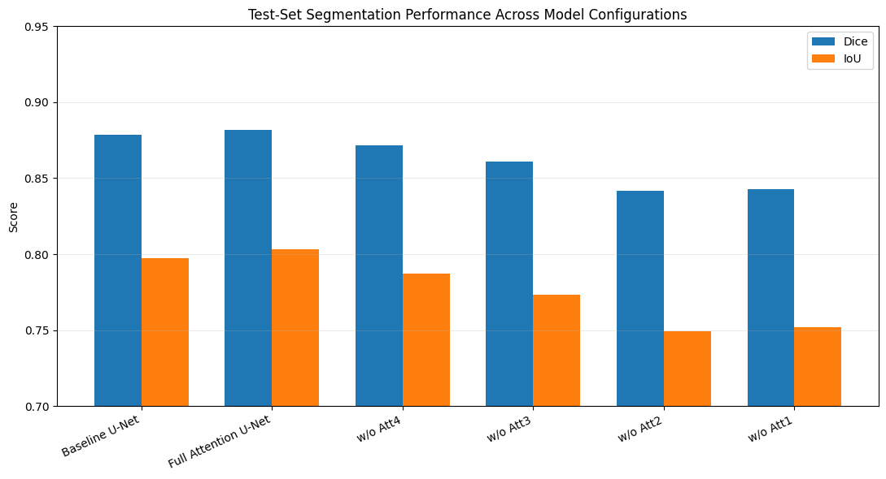
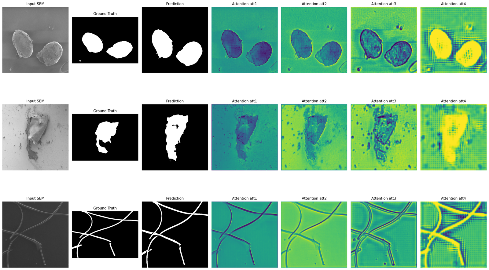
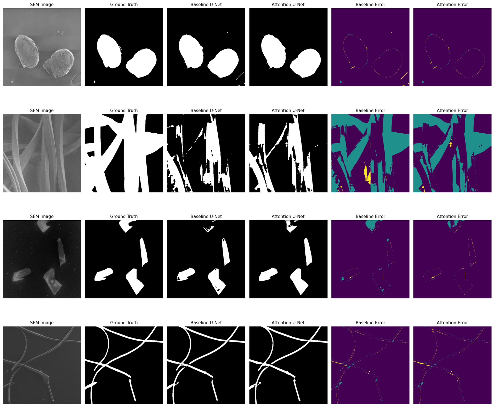
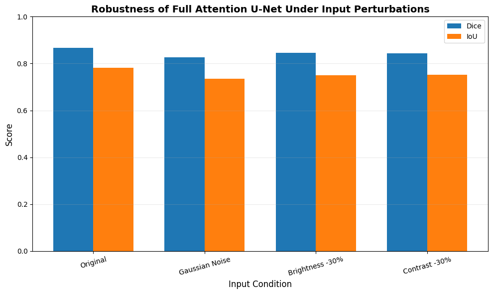

# Attention-enhanced deep learning for microplastic segmentation in SEM images

Code for the paper **"Attention-Enhanced Deep Learning for Microplastic Segmentation in Scanning Electron Microscopy Images"**, accepted at AAI 2026, the International Conference on Advances in Artificial Intelligence (UniMAP, Langkawi, Malaysia, 21 to 23 December 2026).

Authors: Jannatul Jeor Bushra (first author), Nadim Mahmud (second author) and co-authors. The idea and all of the code in this repository are by Nadim Mahmud.

## The question

Counting and outlining microplastic particles in scanning electron microscope (SEM) images by hand is slow, and two people often draw the same particle differently. This project asks whether attention gates help a U-Net find those particles more accurately, which gates matter, and how well the model holds up when image quality drops.

## What the notebook does

1. Checks the dataset: 237 SEM image and mask pairs, how the masks are encoded, and seven RGBA masks that need special decoding.
2. Builds a leakage-safe split. Paired and near-duplicate images are kept on the same side, giving 167 training, 36 validation and 34 test images. The test set is only used for final evaluation.
3. Trains a baseline U-Net and a four-gate Attention U-Net with the same settings: 512 x 512 input, BCE + Dice loss, AdamW (lr 1e-4), up to 50 epochs with early stopping, seed 42.
4. Runs an ablation that removes each attention gate in turn and retrains.
5. Looks at the attention maps on test images.
6. Tests the attention model under Gaussian noise, 30% lower brightness and 30% lower contrast.

## Results (test set, 34 images)

| Model | Dice | IoU | Precision | Recall | Specificity |
|---|---|---|---|---|---|
| Baseline U-Net | 0.8788 | 0.7975 | 0.8848 | 0.8891 | 0.9774 |
| Attention U-Net (4 gates) | **0.8817** | **0.8031** | **0.9042** | 0.8737 | **0.9832** |
| without gate 4 | 0.8717 | 0.7871 | 0.8666 | 0.8923 | 0.9746 |
| without gate 3 | 0.8607 | 0.7735 | 0.8695 | 0.8689 | 0.9781 |
| without gate 2 | 0.8416 | 0.7495 | 0.8095 | 0.9095 | 0.9540 |
| without gate 1 | 0.8426 | 0.7520 | 0.8415 | 0.8653 | 0.9719 |

The attention model gives a small gain in Dice and IoU and a clearer gain in precision, at some cost in recall. Removing any single gate makes it worse, and the two gates closest to full resolution (gates 1 and 2) matter most.

Robustness of the Attention U-Net, relative drop in Dice: Gaussian noise 4.7%, brightness -30% 2.5%, contrast -30% 2.6%.

## Data

[Microplastics_SEM](https://data.mendeley.com/datasets/z6459vntbr/3) by Bin Shi and Jane Howe, Mendeley Data, version 3, DOI [10.17632/z6459vntbr.3](https://doi.org/10.17632/z6459vntbr.3), licensed CC BY 4.0. The images are not copied into this repository. The notebook uses the `[datasets_full]_Exp1_Exp4` subset (237 images).

## Running it

The notebook was run on Kaggle with two Tesla T4 GPUs, Python 3.12 and PyTorch 2.10. To run it again:

1. Download the dataset from Mendeley Data and add it to a Kaggle notebook (or any machine with a GPU).
2. Install the packages in `requirements.txt`.
3. Point the dataset path in the "Locate the Dataset" cell to where you put the data, then run all cells.

Checkpoints, CSV results and figures are written to a `microplastic_project/` folder.

## License

Code: MIT (see `LICENSE`). Dataset: CC BY 4.0, owned by its authors.
